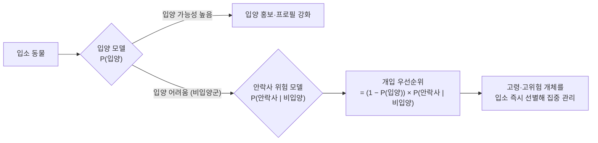
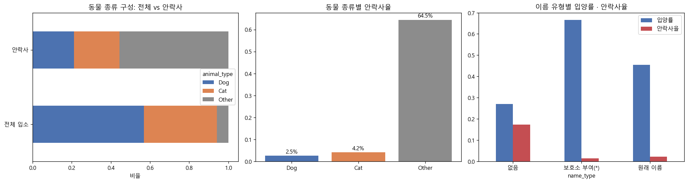
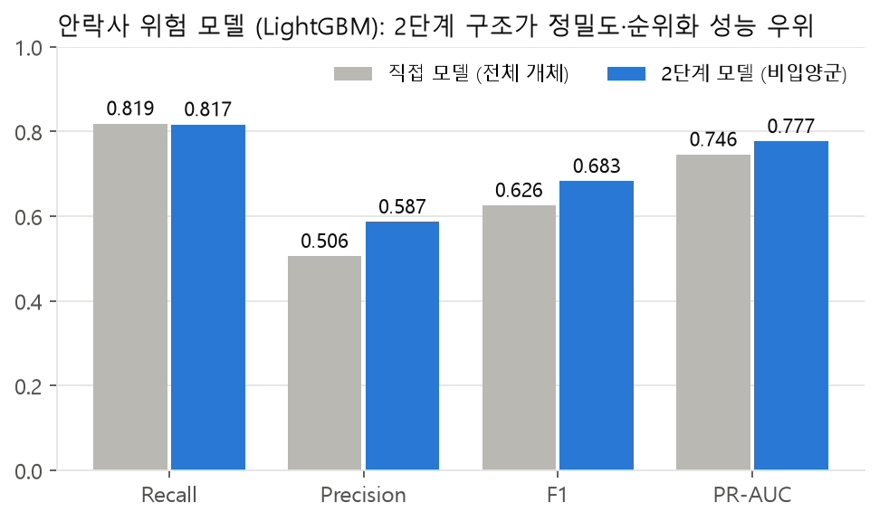
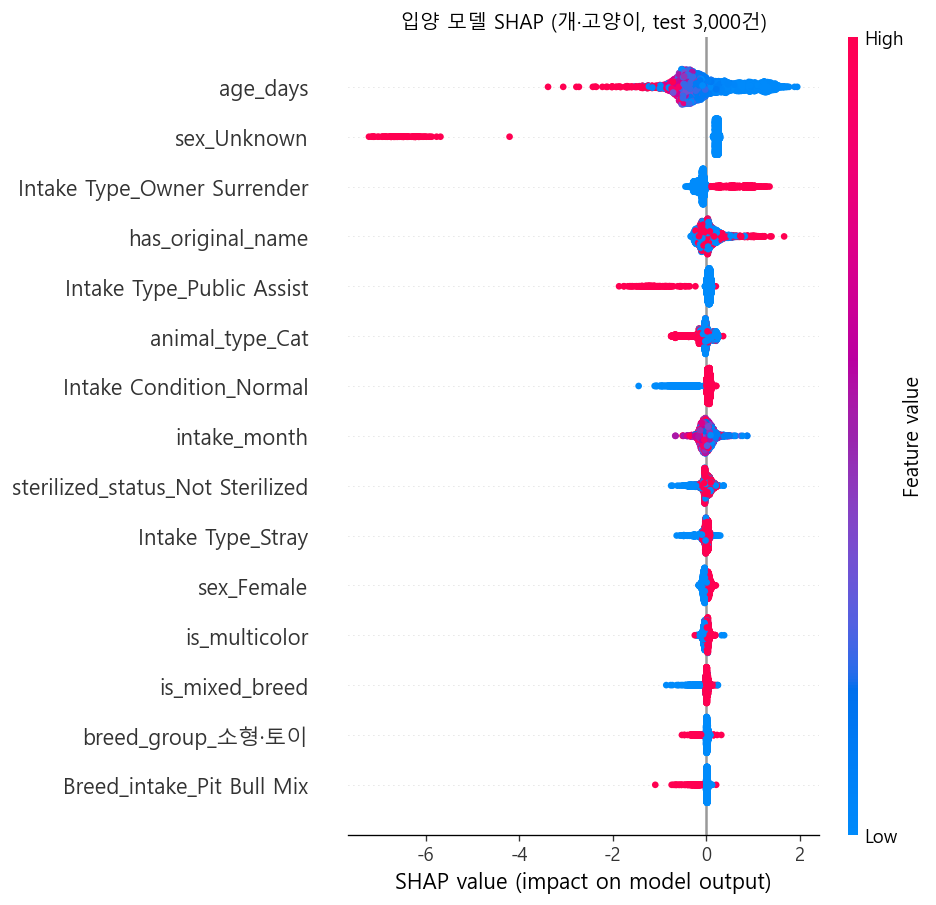
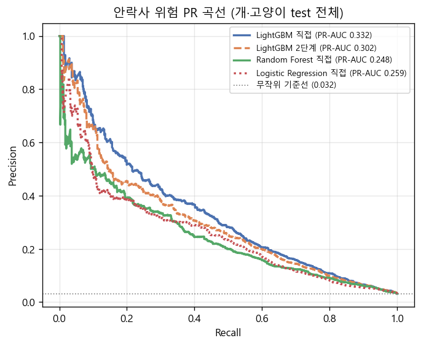
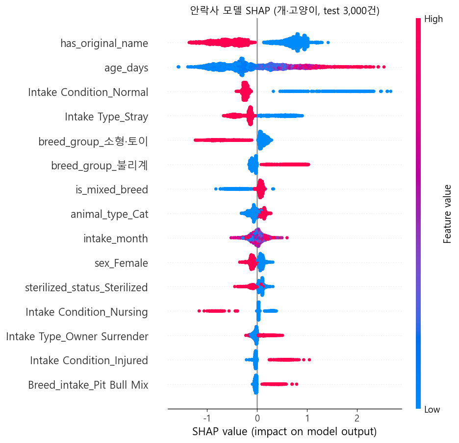
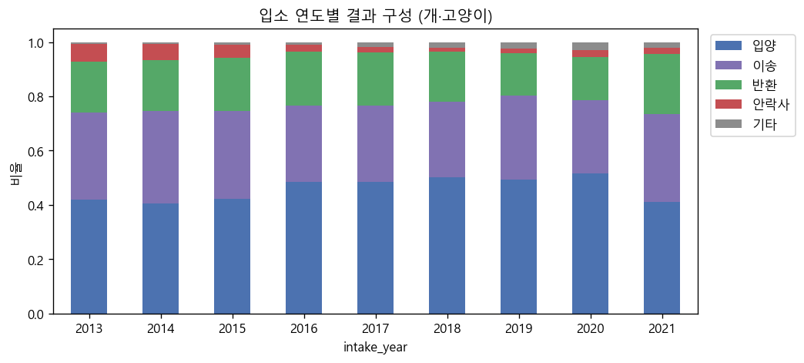

# 보호소 운영 우선순위를 위한 2단계 예측

> **교내 AI 학회 MATRIX 컨퍼런스 2조 · 팀 조장 · 2026.07–08 · 참가 10팀 중 최우수상**
>
> 오스틴 동물센터 입·퇴소 기록으로, 보호소가 **어떤 동물에게 먼저 개입해야 하는지** 정하는 우선순위 점수를 만든 프로젝트입니다.

## 한눈에 보기

| 핵심 | 내용 |
|---|---|
| **문제 재정의** | 5개 퇴소 결과 다중분류(기타 F1 0.13) → **입양 여부 + 비입양군 안락사 위험**의 2단계 이진 분류 |
| **입양 모델** (LightGBM) | 실제 비입양 개체의 **69.2%** 를 사전 식별, 비입양 예측 중 **79.7%** 가 실제 비입양 |
| **안락사 위험 모델** (비입양군 LightGBM) | Recall **0.817** · PR-AUC **0.777** (전체 개체 직접 모델 0.746보다 높음) |
| **결과물** | 두 예측을 곱한 개입 우선순위 점수 + 보호소 운영 지침 |
| **역할** | 팀 조장: 문제 정의, 역할·일정 조율, 분석을 발표 구조로 정리 |

---

## 1. 문제 정의 — 다중분류 대신 두 개의 질문

- 입양·반환·이송·안락사·기타를 그대로 다중분류하면 소수 클래스를 구분하기 어렵다 (정확도 0.61, 기타 F1 0.13).
- 보호소의 실제 질문은 "누가 입양될까?"와 "입양이 어려운 동물 중 누구에게 먼저 개입해야 할까?" 두 가지다.

## 2. 데이터와 특성 공학

| 처리 | 내용 |
|---|---|
| 타깃 | 5개 퇴소 결과를 탐색한 뒤 목적별 이진 타깃 2개로 파생 |
| 이상치 | 나이 오류 7건 삭제, 나이는 연속형 유지 + 생애단계(새끼·성체·노령) 파생 |
| 고카디널리티 | 품종 2,619종·색상 594종을 원-핫하지 않고 상위 15개 그룹 + 혼종·단색·다색 상위범주로 묶음 |
| 이름 | 'Unknown'을 명시하고 `has_name` 파생 (예측 핵심 변수) |
| 검증 | Animal ID 그룹 분할 (같은 동물이 학습·평가에 나뉘지 않게) |

## 3. 모델링

Logistic Regression · Random Forest · LightGBM을 비교했고, 비선형 상호작용 학습·고차원 범주형 처리·SHAP 해석 가능성을 종합해 **LightGBM**을 골랐습니다. 정확도 대신 소수 클래스 지표(Recall·PR-AUC)를 기준으로 미탐지 비용을 고려했습니다.

| 안락사 위험 모델 | Recall | Precision | F1 | PR-AUC | ROC-AUC |
|---|---|---|---|---|---|
| 직접 모델 (전체 개체) | 0.819 | 0.506 | 0.626 | 0.746 | 0.941 |
| **2단계 모델 (비입양군, 최종)** | 0.817 | **0.587** | **0.683** | **0.777** | 0.932 |

같은 재현율에서 2단계 모델의 정밀도가 높아, 검토해야 할 오경보가 줄어듭니다.

### 입양 예측의 주요 요인

| 요인 | 방향 | 운영 제안 |
|---|---|---|
| 성별 미확인 | 입양 예측값 크게 감소 | 입소 초기 개체 정보 확보 강화 |
| 고연령 | 감소 | 고령 동물 맞춤 입양 지원 |
| 이름 보유 | 증가 | 개체 프로필·홍보 강화 |
| 입소 유형 | 유형별 차이 | 입소 유형별 차별화된 관리 |

### 안락사 위험 모델 (발표 후 개선판)

 

## 4. 돌아보며 — 후속 연구로 이어진 질문

위 입양 모델 SHAP에서 **성별 'Unknown'이 2위**로 나온 것이 마음에 걸렸습니다. 발표 후 이 기록이 결과가 정해진 뒤에 채워지는 값일 수 있다는 점과, 무작위 분할이 운영 성능을 부풀릴 수 있다는 점을 따로 검증했고, 실제로 누수임을 확인해 단독 논문으로 발전시켰습니다.

→ **[shelter-euthanasia-evaluation](https://github.com/j2tori-design/shelter-euthanasia-evaluation)** — 동물보호소 안락사 예측에서 평가 설계가 보고 성능에 미치는 영향

---

## 저장소 구성

| 파일 | 내용 |
|---|---|
| `컨퍼런스2조 발표자료.pdf` | **컨퍼런스 발표자료 (최종 결과)** |
| `Animal_Shelter_Analytics_Final.ipynb` | 발표 기준 분석 노트북 (전처리 → EDA → 2단계 vs 직접 모델 비교 → 불균형 처리) |
| `Animal_Shelter_v2_노트북_설명보고서.pdf`, `Animal_Shelter_프로젝트_분석보고서.pdf` | 노트북 설명·분석 보고서 |
| `2조_기획서_코멘트.docx` | 기획서와 지도 코멘트 |
| `figures_v2/` | 발표 후 개선 분석 그림 |
| `docs/readme/` | 이 README의 요약 차트 |

## 데이터

Austin Animal Center Intakes / Outcomes (City of Austin Open Data Portal). 용량 문제로 저장소에는 포함하지 않았습니다.

---

**기술:** Python · pandas · scikit-learn · LightGBM · SHAP · 특성 공학(고카디널리티 범주 그룹화) · 그룹 분할 검증

---

👤 [전건우 GitHub 프로필](https://github.com/j2tori-design) · 📂 [전체 프로젝트 목차](https://github.com/j2tori-design/contest-portfolio)
